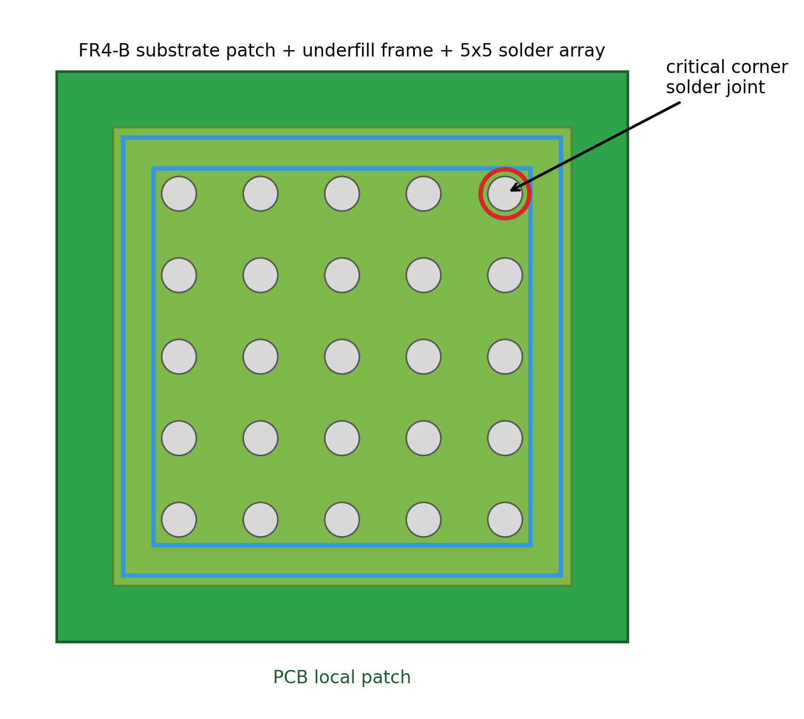
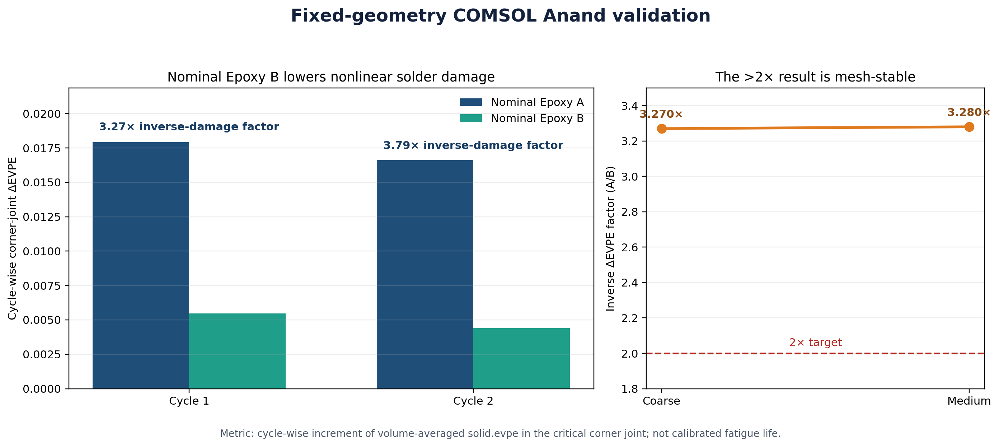

# Underfill Reliability Surrogate

Picking an underfill material that makes BGA solder joints last longer under automotive thermal cycling, using COMSOL simulations and a Gaussian-process surrogate. This was a finalist entry (7 worldwide) in the IEEE ESTC 2026 Student Competition, presented at the 11th ESTC conference in Helsinki, September 2026.

## Background

Solder joints under a BGA package crack because the package and the PCB expand by different amounts when the temperature changes. Underfill, an epoxy that fills the gap between them, shares that load, but only if its stiffness, thermal expansion and glass-transition temperature (Tg) are right.

The competition ("Predictive Modeling and Design Optimization for Advanced Electronic Packaging") posed this as a design task:

- model a given BGA package on a PCB under a −40 to 125 °C thermal cycle,
- find the critical solder joints,
- propose an underfill that improves reliability by at least 2×, without changing the geometry or the solder.

The organizers' documents and CAD model are in the repository:

| File | What it is |
|---|---|
| `competition/ESTC2026_Call_for_Participation.pdf` | Competition announcement and rules |
| `competition/ESTC2026_Technical_Subject_Overview.pdf` | Technical task, materials and load case |
| `underfill_screening/geometry/estc2026_model_solder.stp` | The supplied STEP model |

These three files were provided by the ESTC 2026 Student Competition organizers and remain theirs; they are included only so the study can be followed.

## The model

The STEP file is a BGA component on a 100 × 100 mm PCB with 543 solder joints at 1.00 mm pitch.

Solving all 543 joints with a viscoplastic solder model is too slow for a material search. The study therefore uses a 5 × 5 submodel around the corner joint farthest from the package centre, which sees the largest thermal mismatch.

| Corner submodel | Mesh |
|---|---|
|  |  |

The reference underfill, Epoxy A, has a Tg of 110 °C, so it softens during the 125 °C dwell. Epoxy B (Tg 145 °C) stays stiff over the whole cycle.

## Method

Geometry and mesh stay fixed; only the underfill modulus, thermal expansion and Tg vary.

1. **Sample.** Run a Latin-hypercube set of underfill candidates in COMSOL with a fast elastic stress indicator.
2. **Learn.** Fit a Gaussian process to those runs and let it choose the next candidates (`active_learning.py`).
3. **Verify.** Re-run the best candidates with the Anand viscoplastic solder model over three thermal cycles, then check mesh sensitivity and the full 25-joint submodel.

## Result

Switching from Epoxy A to Epoxy B lowers the per-cycle viscoplastic strain increment in the critical corner joint by a factor of **3.38**, above the 2× target. The full 25-joint check gives 3.39, and refining the mesh changes the factor by 0.3%. This is a relative damage indicator, not a calibrated cycles-to-failure number.

Final numbers: `underfill_screening/final_compliance_verdict.json`.

## Repository layout

| Folder | Contents |
|---|---|
| `competition/` | Organizers' documents |
| `underfill_screening/` | Screening scripts, result summaries (`.json`, `.csv`), STEP model, COMSOL import scripts |
| `cvae_lstm/` | An earlier side study: a CVAE-LSTM network that learns microstructure evolution from phase-field (FiPy) data |
| `docs/` | Figures used above |

The screening scripts need COMSOL Multiphysics and the `mph` Python package; the entry point is `run_pipeline.py`. COMSOL model files, training data and network weights are not included, and the module `comsol_corner_model.py` that builds the COMSOL model is missing from this snapshot, so the scripts document the method but do not run as-is.
