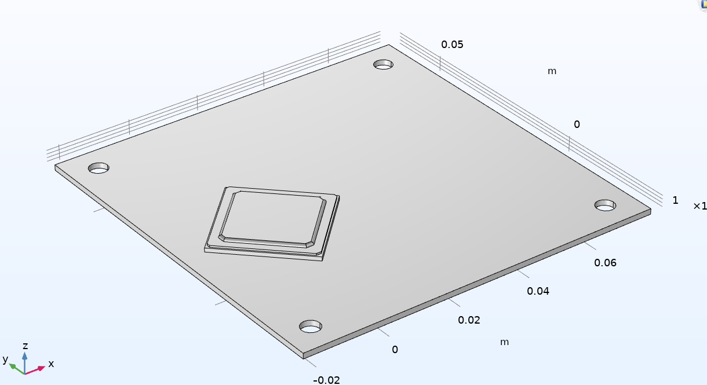
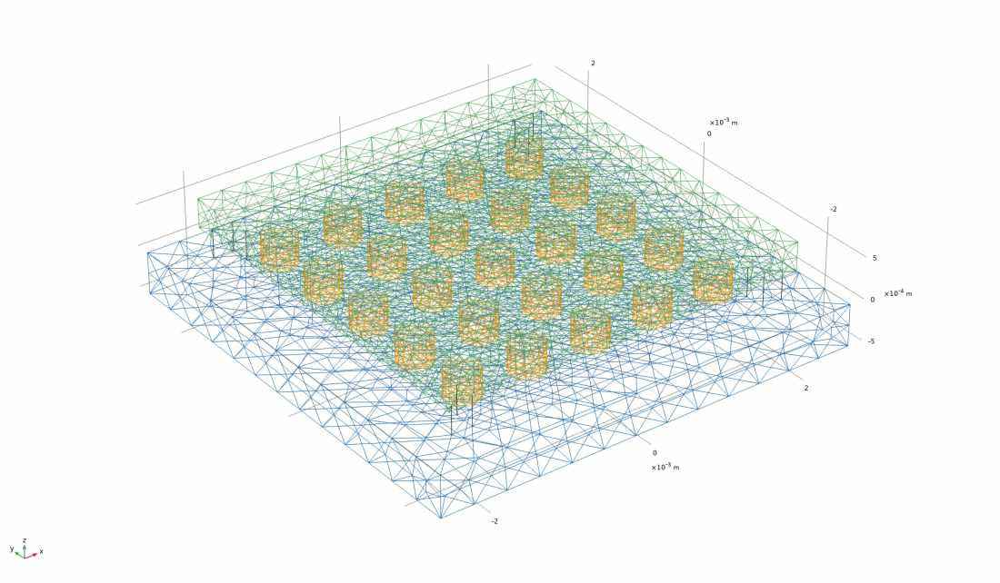
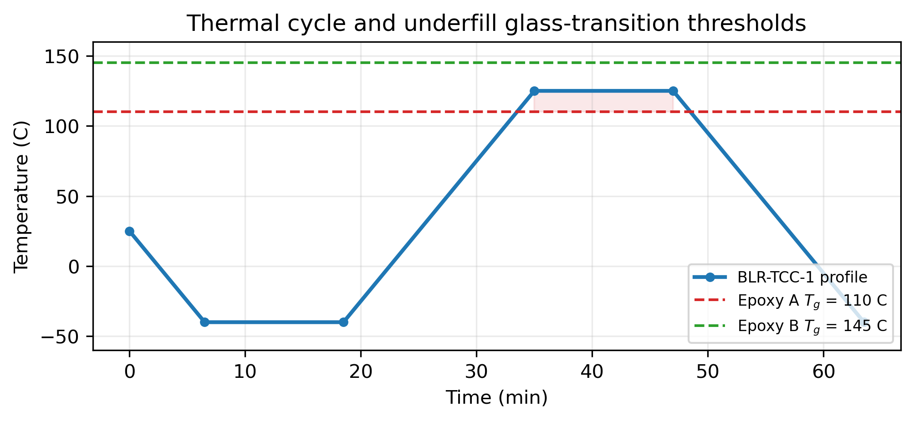
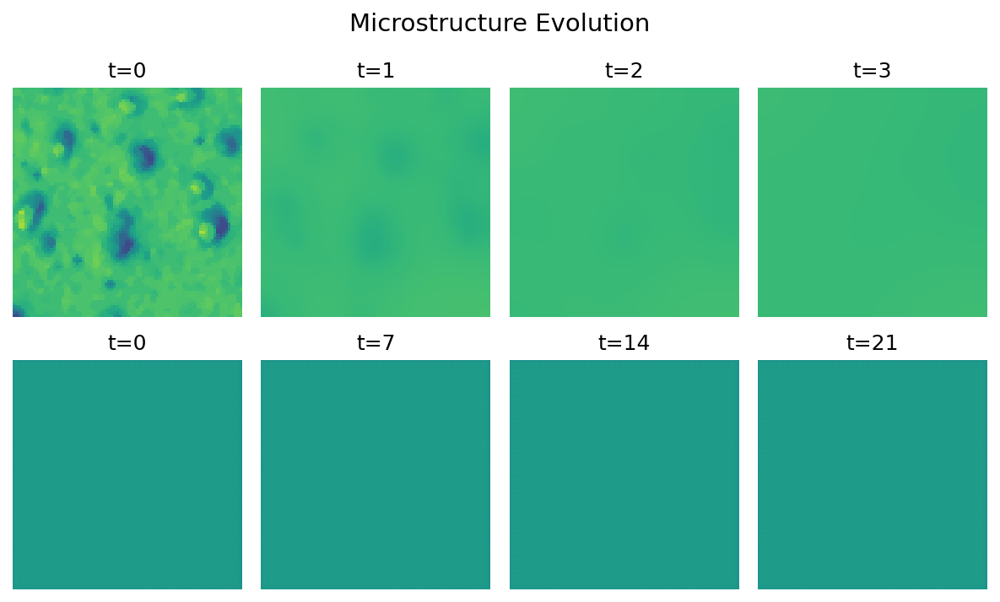

# Underfill Reliability Surrogate

Surrogate models for solder-joint reliability in electronic packaging, in two parts:

1. **`cvae_lstm/`**: a CVAE-LSTM model that predicts microstructure evolution in micro-bumps, replacing a slow phase-field solver.
2. **`underfill_screening/`**: a Gaussian-process screening workflow around COMSOL that picks an underfill material for a BGA package under automotive thermal cycling (−40 to 125 °C). This was our finalist entry in the IEEE ESTC 2026 student competition.

## Competition background

The IEEE ESTC 2026 Student Competition ("Predictive Modeling and Design Optimization for Advanced Electronic Packaging") posed an automotive reliability case: model a BGA package on a PCB under −40 to 125 °C thermal cycling, find the critical solder joints, and identify an underfill choice that improves reliability by at least 2×, without changing the geometry or the solder. This entry was selected as one of 7 finalists worldwide and presented at the 11th ESTC conference in Helsinki, September 2026.

## Geometry and model

The competition supplied the package as a STEP file: a BGA component on a 100 × 100 mm PCB with 543 solder joints at 1.00 mm pitch. Imported into COMSOL it looks like this:



Solving all 543 joints with a viscoplastic solder model is too slow for screening, so the study uses a 5 × 5 corner submodel around the joint farthest from the package centre (17.68 mm), which sees the largest thermal mismatch.

| Corner submodel | Mesh preview from model development |
|---|---|
|  |  |

The load is the −40 to 125 °C thermal cycle. Epoxy A passes its glass transition (110 °C) during the hot dwell and softens; Epoxy B (145 °C) does not.



`underfill_screening/comsol/` has the two COMSOL Java API scripts used to import the STEP file and measure its bounding boxes.

## Results

**CVAE-LSTM surrogate**

| Metric | Value |
|---|---|
| Reconstruction SSIM | 0.977 |
| Latent prediction MSE | 0.0028 |
| Speed vs. FiPy CPU solver (80×80 patches) | 32× |



**Underfill screening**

Switching from the reference Epoxy A to Epoxy B lowers the per-cycle viscoplastic strain increment in the critical corner joint by a factor of **3.38** (minimum over three thermal cycles, Anand solder model). A check with all 25 joints gives 3.39, and refining the mesh changes the factor by 0.3%. This is a relative damage indicator, not a calibrated cycles-to-failure number.


The figure shows an earlier two-cycle run; the final three-cycle numbers are in `underfill_screening/final_compliance_verdict.json`.

## How it works

**CVAE-LSTM.** A residual conditional VAE compresses each microstructure image to a latent vector; an LSTM rolls the latent state forward in time, conditioned on temperature and stress. Training uses MSE, SSIM, Laplacian and KL losses.

```sh
cd cvae_lstm
python generate_fipy_data.py   # phase-field training data
python train_cvae.py
python train_lstm.py
python inference.py
```

Needs PyTorch, NumPy, SciPy, FiPy and matplotlib.

**Underfill screening.** Geometry and mesh are fixed; only underfill modulus, CTE and Tg vary.

1. Latin-hypercube design of experiments with an elastic stress proxy in COMSOL.
2. Gaussian-process fit and lower-confidence-bound selection of new candidates (`active_learning.py`).
3. Validation of the best candidates with the Anand viscoplastic model over three thermal cycles, plus mesh and full-array checks.

Entry point: `run_pipeline.py`. Needs COMSOL Multiphysics with the `mph` Python package. Result summaries are the `.json` and `.csv` files in the folder.

## Not included

Training data, model weights, COMSOL model files and the competition geometry are not in the repository. The module `comsol_corner_model.py`, which builds the COMSOL model and is imported by the screening scripts, is also missing from this snapshot, so those scripts document the method but do not run as-is.
